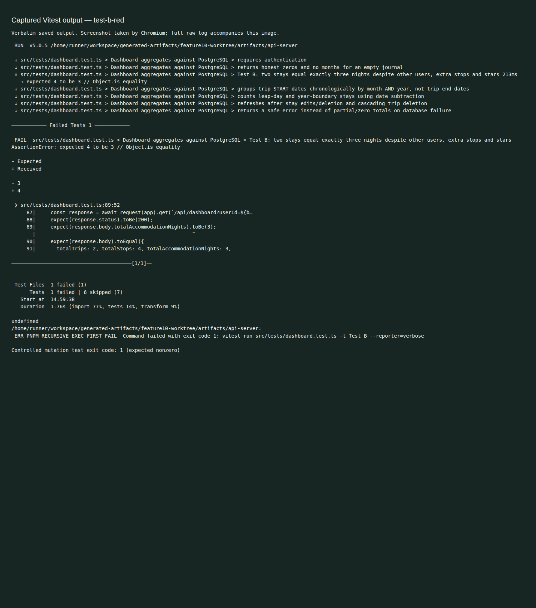
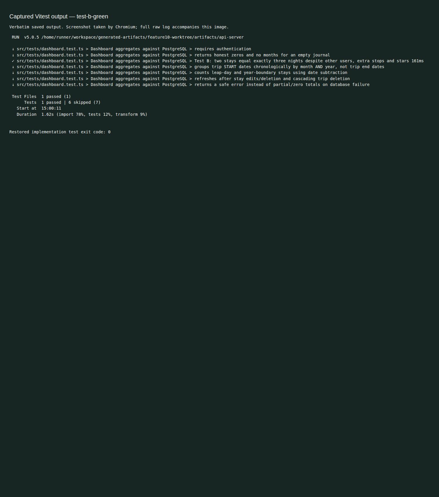
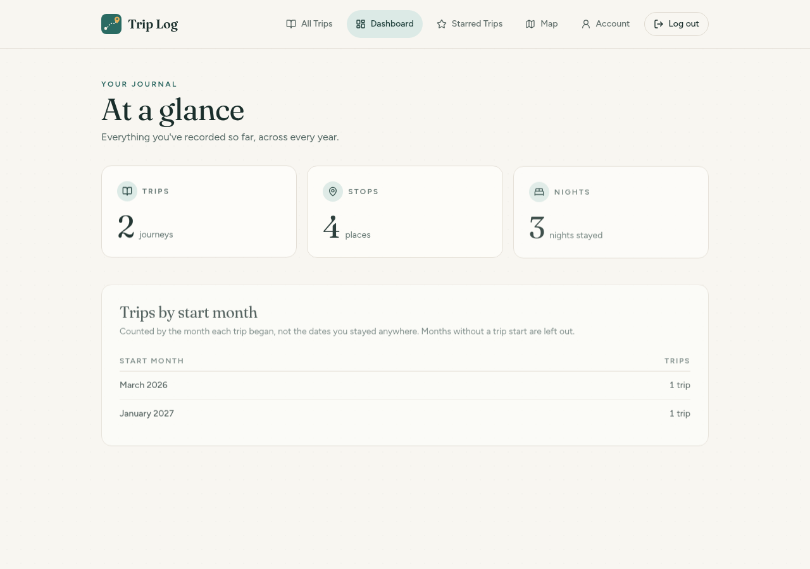

# Feature 10 — Dashboard verification

Issue: [#25](https://github.com/yukobayashi0811/trip-log/issues/25).
Feature branch: `feature/dashboard`, from merged GitHub main
`e445ccc870a3522ff32beb10e4e4b427fae759f1`.
The owner confirmed Feature 9's production checkpoint before this work.
Original `PLAN.md` is unchanged.

## Implementation

Protected `/dashboard`, reachable in desktop/mobile navigation, shows:

- Total owned trips.
- Total stops belonging to those trips, including stops without accommodations.
- Total accommodation nights: sum of `check_out - check_in` for each owned stay.
- Trip counts by **start** month, oldest month first, with year preserved.
  All recorded years are included; months without starts are omitted and explained.

`GET /api/dashboard` uses existing tables and `requireUser`. Ownership comes only
from the authenticated internal user ID, never query parameters. One PostgreSQL
statement/CTE gives all totals the same database snapshot. Independent subqueries
aggregate trips, stops and stays at their own grain; stars are not joined.
Therefore extra stops/stars cannot multiply a trip or a stay's nights.

PostgreSQL `DATE - DATE` yields calendar days without JavaScript timestamps, DST,
timezones or rounding. Checkout is exclusive. Overlapping stays are separate
recorded accommodations, not deduplicated into unique travel dates. An empty
journal returns numeric zeros and an empty month list. Successful responses use
`Cache-Control: no-store`; failures return a safe error, not partial/fabricated zeros.
No schema, index, authentication configuration, provider or resource changes.

The page reuses the existing theme, shell and error panel. Query keys include
the account ID, always refetch on mount and refetch on window focus. Loading
skeletons, true empty states, and an actionable error/Retry are provided.
An error replaces previously cached metrics rather than displaying stale totals
as success. The monthly breakdown is an accessible semantic table with
date-string labels, not timezone-dependent `Date` parsing.

## Mandatory Test B: real controlled green → red → green

The PostgreSQL integration test seeds:

| Owner | Trips | Stops | Stays | Stars |
|---|---:|---:|---|---|
| A | 2 | 4 | March 7→9, 2026 = 2 nights; November 1→2 = 1 night | Both owned trips starred |
| B | 1 | 1 | March 1→11 = 10 nights | Own trip starred, plus defensive legacy cross-owner star fixture |

The extra B→A star is inserted only by the test to guard against accidental
unfiltered joins; the application's existing star API does not permit it.
The test requests A's dashboard with a spoofed `?userId=B`. It must still return
**2 trips, 4 stops, exactly 3 nights**, and only A's March 2026/January 2027 starts.
Then B must receive only **1 trip, 1 stop, 10 nights**.

Actual execution, on 2026-10-22:

1. [Initial green](../evidence/tests/dashboard/initial-green.log): all 7 new dashboard tests passed.
2. Temporarily introduced the explicit
   [controlled mutation](../evidence/tests/dashboard/controlled-mutation.diff):
   add `1` to the summed nights.
3. [Red log](../evidence/tests/dashboard/test-b-red.log):
   Test B failed with **expected 3, received 4**, exit code 1.
4. Removed the mutation.
5. [Restored green log](../evidence/tests/dashboard/test-b-green.log):
   Test B passed, exit code 0 (the other 6 tests were deliberately not selected).
6. The final full suite passed all **255 tests**, including all 7 dashboard tests.




These PNGs are genuine Chromium screenshots of **verbatim saved Vitest output**,
not a screenshot of a live terminal or a fabricated test result. The raw logs
accompany them. [Capture script](../evidence/tests/dashboard/capture-output.mjs).
Early Test B runs used the uncommitted Dashboard route/test on the stated main
base. Their restored backend source matches the subsequent application commit;
the red run differs by the documented temporary mutation only.

**What this proves:** the returned metric is exactly the expected calendar-night
sum despite owner isolation, extra stops/stars, and DST-boundary dates. It also
checks the other totals/months, not merely a helper that the API might not use.
It is evidence for these fixtures, not proof of every possible implementation.

**Changes that would break it:** treating checkout as another overnight;
adding an offset; dropping the owner predicate; aggregating a wide
trip/stop/stay/star join without preserving each grain; or replacing date
subtraction with timezone-dependent timestamp truncation. Companion tests cover
empty accounts, authentication, different years in the same month, leap days,
year boundaries, fresh totals after edits/deletion/cascades, and safe query errors.

## Final automated checks

All run in the isolated feature checkout, with the committed application source
`43f1417fbebe4cea177cbe6a5e0d5ab3c973a56b` and no uncommitted application files.

| Check | Actual result | Evidence |
|---|---|---|
| Complete API Vitest regression suite | **255 passed, 13 files** | [Log](../evidence/tests/dashboard/api-regression.log) |
| Full workspace TypeScript checks | Passed | [Log](../evidence/tests/dashboard/typecheck.log) |
| Existing Feature 9 search tests | **7 passed** | [Log](../evidence/tests/dashboard/search-regression.log) |
| API production build | Passed | [Log](../evidence/tests/dashboard/build-api.log) |
| Frontend production build | Passed | [Log](../evidence/tests/dashboard/build-web.log) |
| Authenticated Chromium journey | **20/20 assertions**, including 3 fixture-cleanup assertions | [Results](../evidence/dashboard-browser/browser-results.json), [log](../evidence/dashboard-browser/browser.log), [script](../evidence/dashboard-browser/run.mjs) |

API regressions used only the local `triplog_test` database; browser verification
used a separate freshly initialized local `feature10_browser` database. No
application/prod database or production schema was queried or changed.
`TZ=America/Los_Angeles` was set for regression execution; the database
calculation itself is timezone-independent. Builds used the exact manifest
`npm exec --yes --package=pnpm@10.26.1 -- pnpm --filter … run build` commands.
Non-blocking warnings: existing npm project-config keys and Vite chunk size.

## Authenticated browser evidence

The built-in tester failed at dispatch with `Unknown config kind: testing`.
The established isolated Chromium/CDP approach was used instead, with actual
temporary **Clerk Development** users and short-lived sign-in tickets. The script
refuses non-`sk_test_` authorization, does not print keys/tickets, and does not
change authentication configuration. It does not bypass authentication.
Clerk's form was not automated.

Real browser/API/database checks:

- Unauthenticated dashboard request rejected with 401.
- A signs in; Dashboard navigation opens honest zeros and an empty state.
- Real authenticated trip/stop/stay/star writes create A's 2/4/3 fixture.
- Dashboard displays 3 nights and the correct year-month rows; reload preserves it.
- Desktop and 390px mobile render without horizontal overflow; mobile nav is
  labelled, visible, and at least 44×44 pixels.
- A deliberately delayed dashboard request shows loading without invented totals.
- A deliberate HTTP 500 on a cached query's remount hides stale metrics, displays
  an actionable error, and Retry recovers from the real API.
- B in an independent context initially sees zeros, then only their own 1/1/10.
  Returning to A still shows 2/4/3 and excludes B's month.
- No unhandled browser exceptions. Synthetic trips were deleted through each
  owner's API; temporary Clerk users were deleted. All data was isolated local test data.

Only the delay/500 checks intercept requests. All successful metrics, ownership
and persistence checks use real responses. Screenshots:




[Empty](../evidence/dashboard-browser/empty-desktop.png) ·
[Loading](../evidence/dashboard-browser/loading-desktop.png) ·
[Error](../evidence/dashboard-browser/error-desktop.png) ·
[User B](../evidence/dashboard-browser/user-b-desktop.png)

Two unsuccessful **harness** attempts are retained, not silently rewritten:
[invalid synthetic email](../evidence/dashboard-browser/attempts/fixture-email/browser.log)
(space in the generated label; no user created) and
[hidden-window focus event](../evidence/dashboard-browser/attempts/hidden-focus-event/browser.log)
(no refetch request was triggered). The test fixture email was corrected, and
explicit SPA remount replaced the unreliable synthetic visibility event. Neither
required an application fix. The final successful run is the root results file.

## Provenance and publishing handoff

Full API/typecheck/build checks and the final browser run tested application
commit `43f1417fbebe4cea177cbe6a5e0d5ab3c973a56b`.
[Source manifest](../evidence/tests/dashboard/source-provenance.json) records
application Git-tree IDs and file SHA-256 digests. Subsequent PR commits add only
documentation and evidence; they do not change the tested application tree.
The final PR application trees must compare equal to that commit:

```sh
git diff --exit-code 43f1417fbebe4cea177cbe6a5e0d5ab3c973a56b HEAD -- artifacts lib
git diff --exit-code github/main HEAD -- PLAN.md
```

The actual publishing workspace, existing backups, `.replit` port map and
deployment settings remain in place. Temporary test servers use the already
mapped isolated ports 23451/23452, not the publishing Preview on 21377/8080.
The temporary Vite `/api` proxy is a test-runtime file outside tracked app config.

**Not yet performed:** merge, Publish, or Feature 10 production verification.
After owner merge, reconcile the actual publishing workspace with merged main,
then the owner can Publish and perform the production checkpoint. Local
verification does not claim that an unmerged feature is already live.
